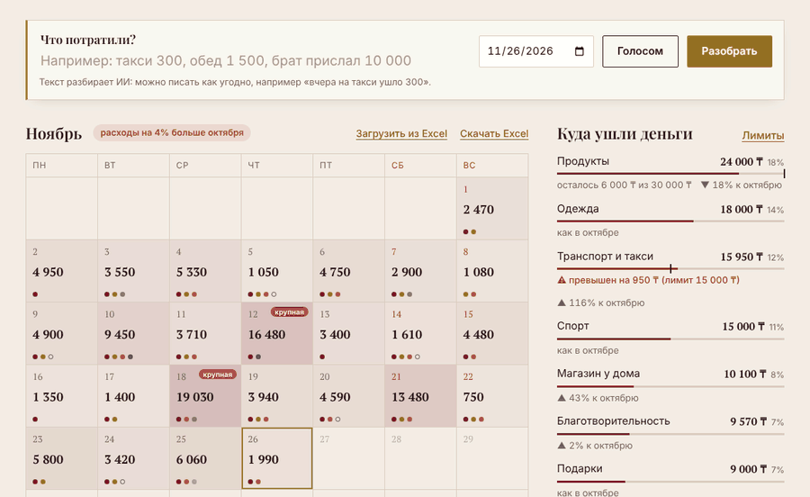
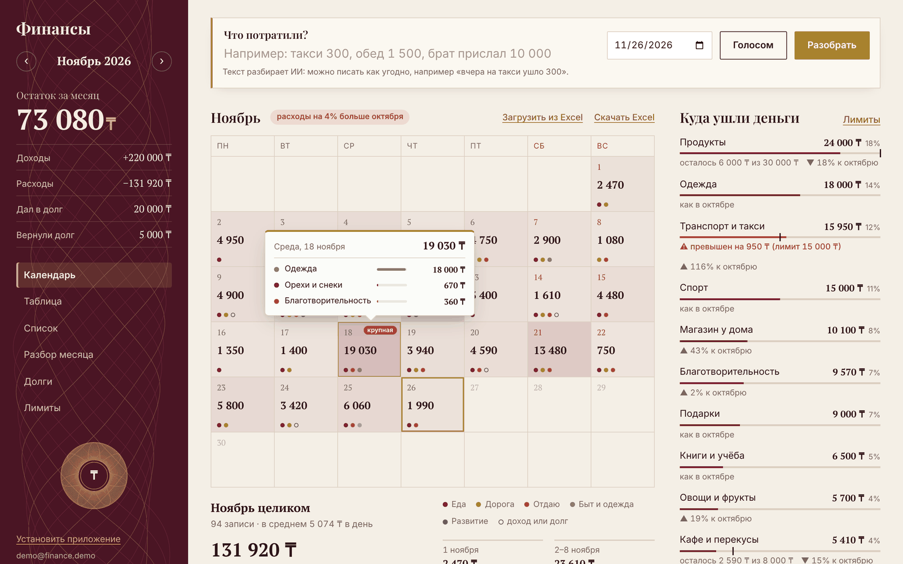
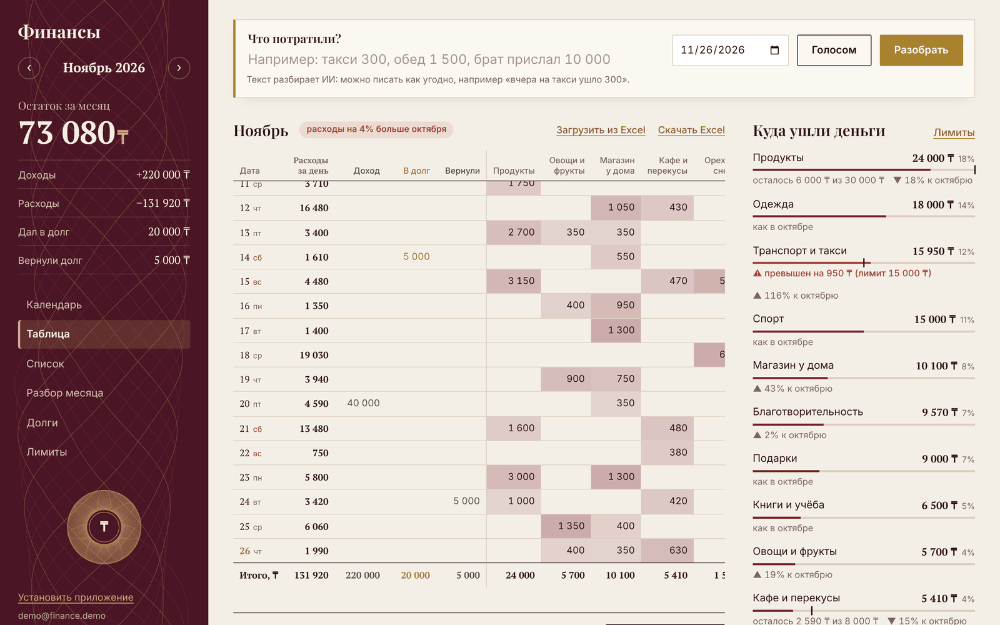
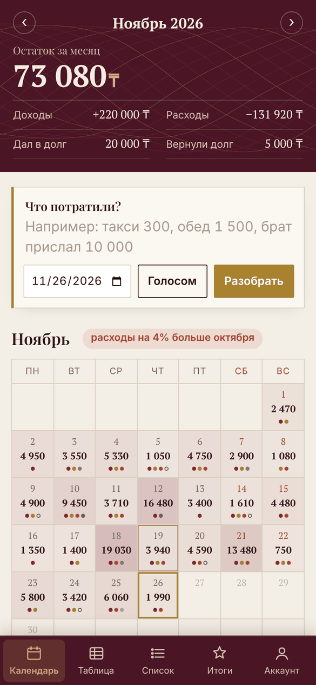
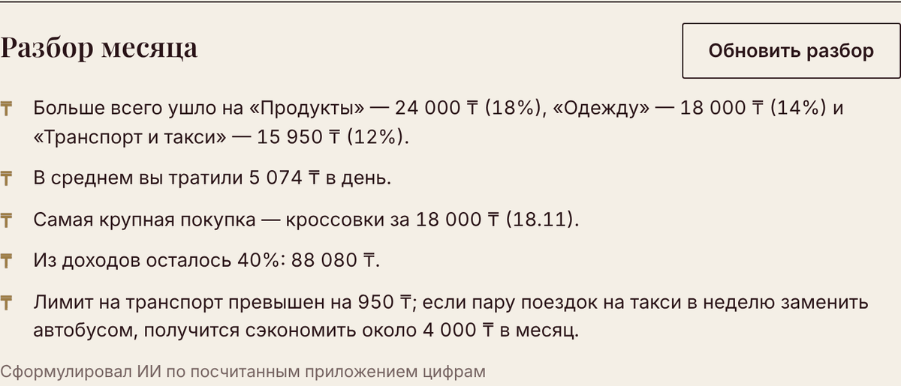
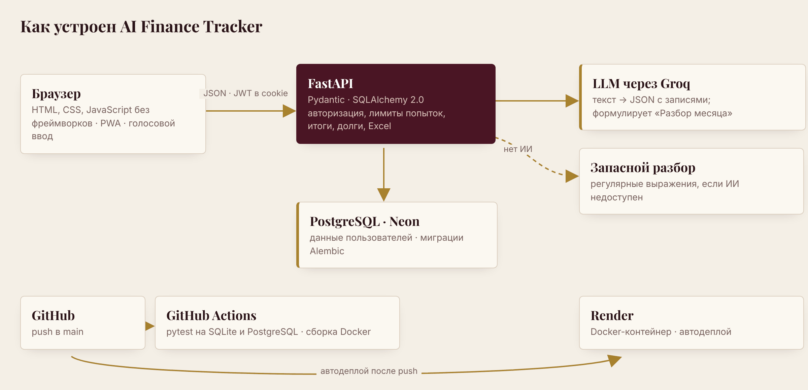

<div align="center">

# AI Finance Tracker

**English** · [Русский](README.ru.md)

**Personal finance tracking in plain text.** Type "taxi 1 200, lunch 1 500, my brother sent 10 000" — an LLM splits it into categorized entries, and the calendar, table, monthly totals and debts update on their own.

[](https://github.com/Karasai69/ai-finance-tracker/actions/workflows/tests.yml)


### [▶ Live demo](https://ai-finance-tracker-05rj.onrender.com) — click «Посмотреть демо без регистрации» (view demo, no sign-up)



</div>

> The interface is in Russian — the app was built for the Kazakhstan market (amounts in tenge, ₸).
> It runs on Render's free tier and sleeps when idle, so the first load can take up to a minute.

## Why

Since early 2026 I logged every expense by hand in Google Sheets: date, category, amount. This app does the same job, but an entry takes five seconds — type or dictate one sentence. I migrated my own year of records into it via the Excel import.

## Features

**Input**
- Free text or voice (Whisper speech-to-text on the server) — the LLM extracts amounts, categories, dates ("yesterday"), income and debts
- Preview before saving: category, amount and date can be corrected
- Learns from corrections: move "samsa" to "Cafe" once and it lands there next time
- Keyword-based fallback parser when the LLM is unavailable

**Monthly overview**
- Calendar: daily totals, heat shading, "big spend" badges, per-day breakdown on hover, summary for the month, a week or a day
- Spreadsheet-style "days × categories" table (on phones: categories × weeks)
- Separate screens: Calendar, Table, Summary, Debts — bottom tab bar on phones
- Balance, income, expenses, debts; comparison with the same days of the previous month — overall and per category
- Per-category budgets with over-limit warnings
- Who owes me what, across all months, with full or partial "paid back"
- Savings: "put aside 20 000" / "took 5 000 from savings" — a separate running total that is neither income nor expense
- Year overview: income, expenses and savings by month, the most and least expensive months, top categories vs. last year
- "Month review" by the LLM: where the money went and realistic ways to save. The app computes every number; the model only phrases them, so it can't invent figures

**Data and account**
- Excel export (entries sheet + "by day" sheet) and import back
- Undo after deleting an entry or a whole debt
- Sign-up, password change (logs out other devices), account deletion with all data
- One-click demo account, re-seeded on every login
- Installable on a phone as a PWA

## Screenshots

| Calendar with day tooltip | "Days × categories" table |
| --- | --- |
|  |  |

| Phone | LLM month review |
| --- | --- |
|  |  |

## Architecture



1. Text goes to `POST /api/parse`. The model returns JSON with a list of operations, validated by Pydantic: an unknown category becomes "Other", entries without an amount are dropped, and the operation type is always derived from the category.
2. The user's habits are applied on top — the latest corrected categories for the same descriptions.
3. The user reviews the preview and saves (`POST /api/transactions`).
4. Totals, comparisons and debts are SQL `GROUP BY` queries, each scoped to the current user.
5. For the month review the app computes the facts itself (shares, daily average, biggest purchases, changes vs. last month); the model only turns them into sentences.

### Interesting problems

- **The LLM must not get money wrong.** The model never calculates: amounts arrive pre-formatted, and missing data (e.g. an empty previous month) is left out of the prompt entirely — otherwise it started "comparing" against zero.
- **Logging out every device after a password change** without a sessions table: the JWT carries a short fingerprint of the password hash, so old tokens stop matching once the password changes.
- **Brute-force protection** — attempts are limited per IP and email; the same limit guards password change and account deletion.
- **Migrations on a live database.** The schema changes only through Alembic migrations applied at startup; databases created before migrations existed are detected and brought up to date.

## Tech stack

| Area | Technologies |
| --- | --- |
| Backend | Python 3.12, FastAPI, SQLAlchemy 2.0, Alembic, Pydantic v2 |
| Database | PostgreSQL (production and CI), SQLite (local) |
| Auth | JWT in an httpOnly cookie, scrypt, rate limiting |
| AI | LLM via an OpenAI-compatible API (Groq; Gemini or OpenAI also work) |
| Frontend | HTML, CSS, vanilla JavaScript, SVG, Web Speech API, PWA |
| Files | openpyxl — Excel export and import |
| Infrastructure | Docker, Docker Compose, GitHub Actions, Render, Neon |
| Tests | pytest — ~80 tests: text parsing, LLM responses, auth, per-user data isolation, migrations, Excel |

## Running locally

Requires Python 3.10+.

```bash
git clone https://github.com/Karasai69/ai-finance-tracker.git
cd ai-finance-tracker

python -m venv .venv
.venv\Scripts\activate          # Windows
# source .venv/bin/activate     # macOS / Linux

pip install -r requirements-dev.txt
cp .env.example .env            # Windows: copy .env.example .env

uvicorn app.main:app --reload
```

Open http://127.0.0.1:8000 and sign up. API docs: http://127.0.0.1:8000/docs.

### Enabling the LLM (free, Groq)

1. Sign up at https://console.groq.com and create a key under **API Keys**.
2. Put it into `.env`:
   ```
   AI_API_KEY=your_key
   AI_BASE_URL=https://api.groq.com/openai/v1
   AI_MODEL=openai/gpt-oss-20b
   ```
3. Restart the server. Any provider with an OpenAI-compatible API works — change `AI_BASE_URL` and `AI_MODEL`.

### Docker with PostgreSQL

```bash
docker compose up --build
```

## Deploy: Render + Neon (free)

1. **Database.** Create a project at https://neon.com and copy the `postgresql://...` connection string.
2. **Server.** On https://render.com: **New → Blueprint**, pick this repository — Render reads `render.yaml`.
3. Set `DATABASE_URL` (from Neon), `AI_API_KEY` and `AI_MODEL`. Render generates `SECRET_KEY` itself.

## Tests

```bash
pytest
```

GitHub Actions runs the suite on every push twice — on SQLite and on PostgreSQL — and checks that the Docker image builds.

## API

Interactive docs at `/docs` (Swagger). Everything except sign-up, login, demo, `/api/health` and `/api/categories` requires authentication.

| Method | Path | Purpose |
| --- | --- | --- |
| POST | `/api/auth/register` · `/login` · `/logout` | Sign up, log in, log out |
| POST | `/api/auth/demo` | Log into the demo account |
| GET | `/api/auth/me` | Current user |
| POST | `/api/auth/password` | Change password |
| DELETE | `/api/auth/account` | Delete account and data |
| POST | `/api/parse` | Text → list of entries (not saved) |
| POST | `/api/transactions` | Save entries |
| GET | `/api/transactions?month=2026-11` | Entries for a month |
| PATCH / DELETE | `/api/transactions/{id}` | Edit or delete an entry |
| GET | `/api/summary?month=2026-11` | Monthly totals and comparison |
| POST | `/api/insights?month=2026-11` | Month review |
| GET | `/api/debts` | Debts by person |
| GET · PUT | `/api/budgets` · `/api/budgets/{category}` | Budgets |
| GET | `/api/export.xlsx?month=2026-11` (or `?all=true`) | Excel export |
| POST | `/api/import` | Excel or CSV import |

## Roadmap

- [ ] Receipt photo → entries
- [ ] Bank statement import
- [ ] Recurring payments (rent, subscriptions)

## Author

4th-year Computer Engineering student at Al-Farabi Kazakh National University (KazNU) — [github.com/Karasai69](https://github.com/Karasai69)
